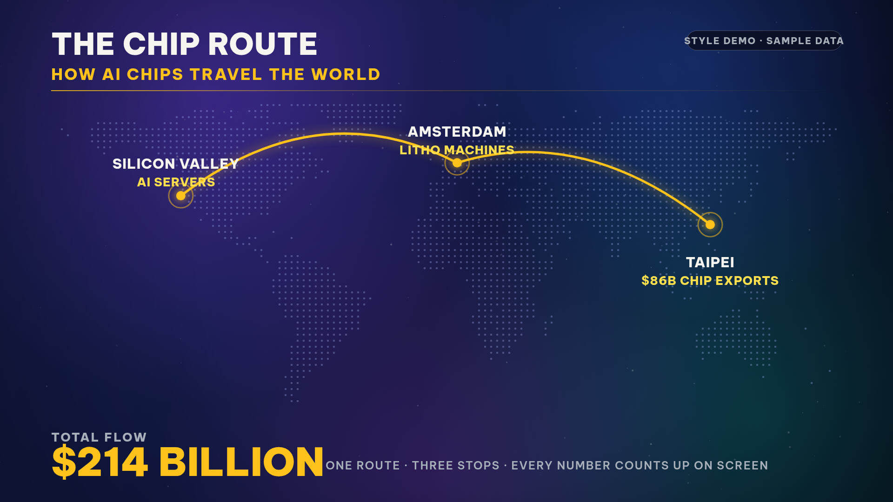
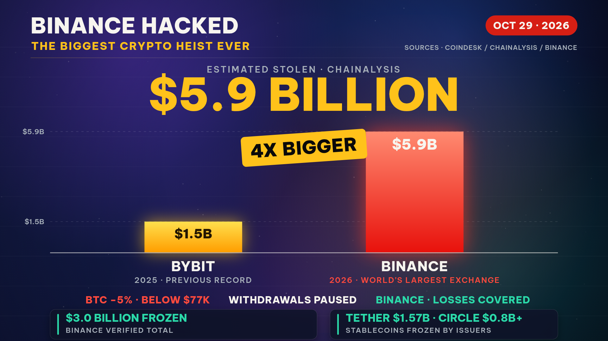
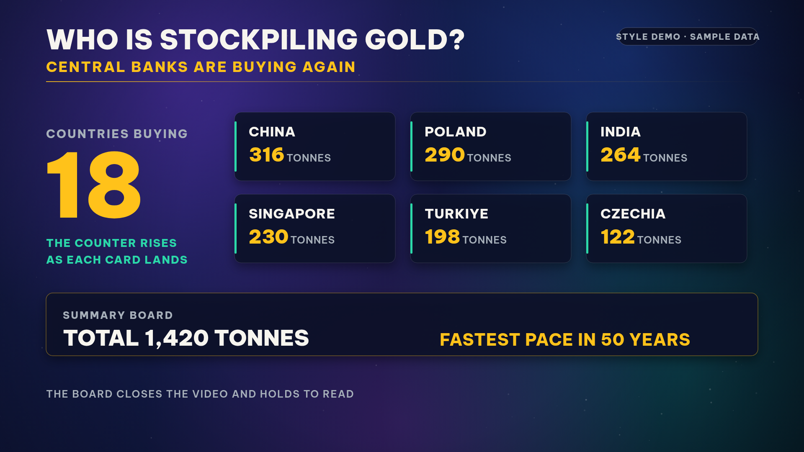
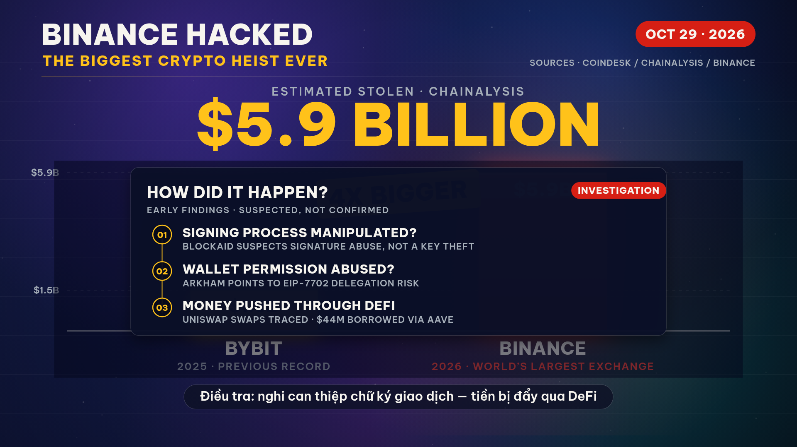
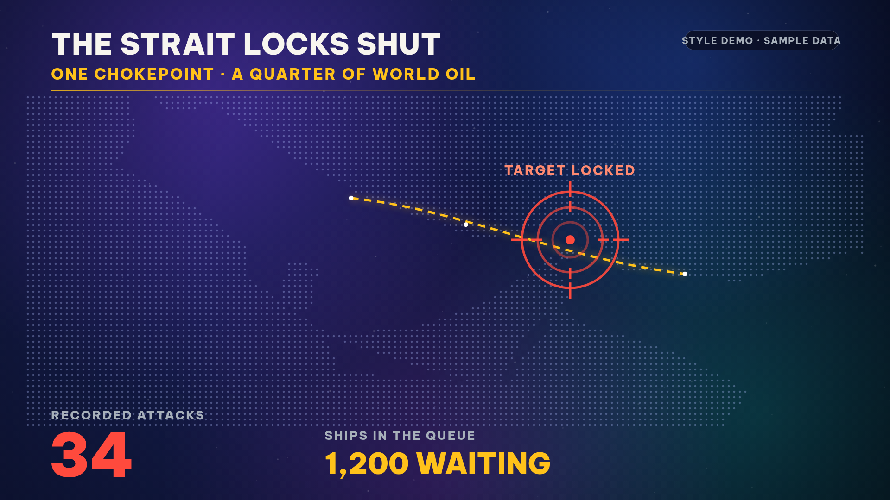
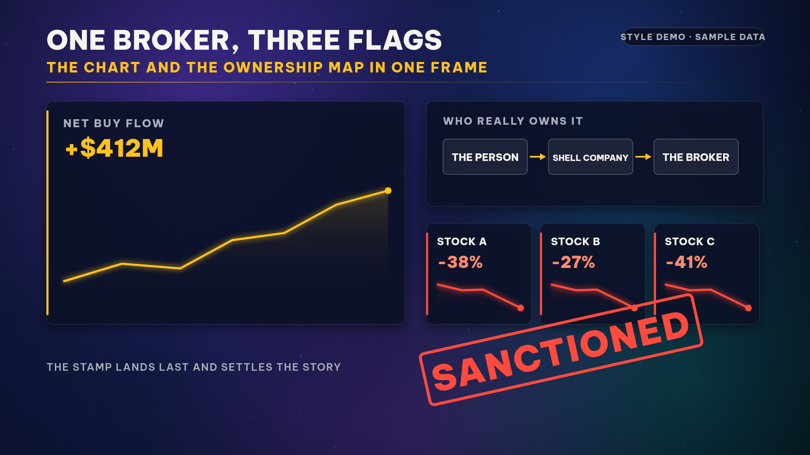
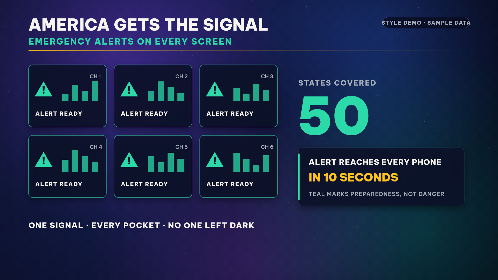
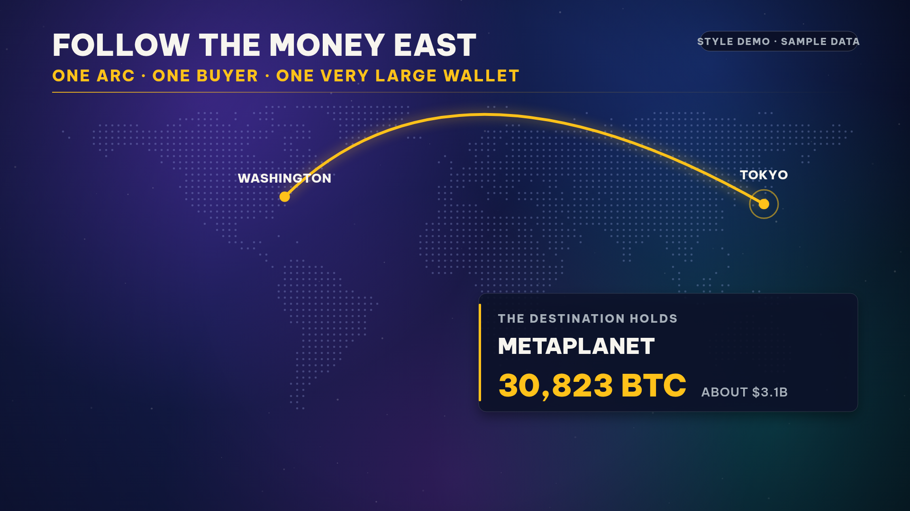
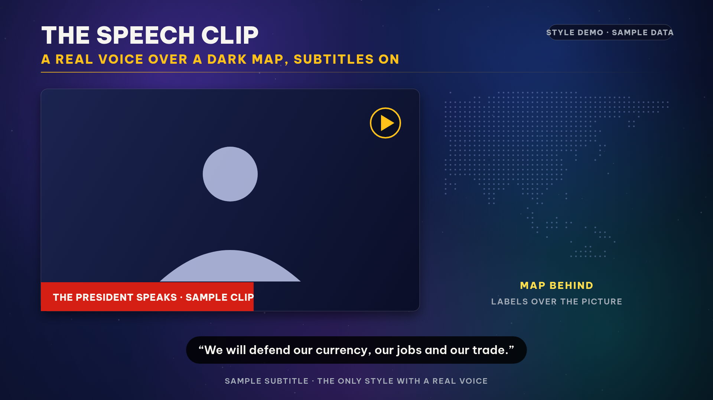

# Alec-Style Dark Data Video — Skill

**Tác giả: Aladinvietnam**

Một **skill** (bộ hướng dẫn quy trình) giúp AI agent dựng các video dữ liệu ngắn kiểu @ItsRealAlec trên X: ngang 16:9, một video chỉ kể **một câu chuyện dữ liệu với một con số chính**, đồ hoạ nền tối rực rỡ, dữ liệu tự chuyển động trên màn hình, có giọng đọc và nhạc nền sáng tác riêng cho từng video.

Skill được đúc kết từ 8 video tham chiếu của @ItsRealAlec (ghi chú chi tiết từng video trong [references/alec-reference-videos.md](references/alec-reference-videos.md)) và tinh chỉnh qua thực tế sản xuất.

## Các mẫu phong cách

| Mẫu | Khi nào dùng |
|---|---|
| **Map Tour** | Câu chuyện di chuyển qua nhiều địa điểm, mỗi điểm dừng thêm một nhãn và một con số |
| **Chart Duel** | So sánh độ lớn, tăng hoặc sụp đổ: một cột hoặc đường phải thắng hoặc thua rõ ràng trước một mốc chuẩn đã biết |
| **Count and Board** | Nhiều quốc gia hoặc chủ thể cùng làm một việc: bộ đếm tăng dần và chốt bằng bảng tổng kết toàn màn hình |
| **Target Lock** | Cả câu chuyện nằm ở một điểm nóng duy nhất: bản đồ phóng to vào eo biển, biên giới hoặc cơ sở, vòng ngắm khoá mục tiêu và một con số đỏ khổng lồ |
| **Evidence Collage** | Một khung hình chứa biểu đồ chính, sơ đồ sở hữu hoặc dòng tiền và nhiều biểu đồ rơi nhỏ, chốt bằng tem phán quyết đỏ |
| **Screen Grid** | Câu chuyện về cảnh báo hoặc phát sóng tới mọi người: mở bằng lưới màn hình phát sáng, xanh ngọc làm màu chủ đạo, chốt bằng bộ đếm độ phủ |
| **Arc and Card** | Tiền hoặc hàng chỉ di chuyển giữa đúng hai nơi: một cung vàng duy nhất, phóng vào điểm đến và hạ một thẻ nắm giữ lớn tại đó |
| **Speech Clip** | Một phát biểu thật là trung tâm: người nói trên nền bản đồ tối, phụ đề luôn hiện (chỉ dùng khi có clip được duyệt) |

Có thêm một pha tuỳ chọn **Investigation** (phân tích nguyên nhân kiểu điều tra): bảng bằng chứng phủ lên biểu đồ đã làm mờ, các phát hiện hiện lần lượt theo dòng thời gian đánh số, mỗi phát hiện ghi rõ nguồn và đánh dấu “nghi vấn, chưa xác nhận” khi nguyên nhân chưa được khẳng định.

## Thư viện phong cách

**Map Tour** — bản đồ chấm sáng, tuyến đường vàng vẽ theo từng chặng, số tổng chốt ở góc:



**Chart Duel** — hai cột đối đầu, con số chính khổng lồ, huy hiệu phán quyết (ảnh thật từ ví dụ Binance):



**Count and Board** — bộ đếm tăng theo từng thẻ, chốt bằng bảng tổng kết:



**Investigation** — pha phân tích nguyên nhân: bảng bằng chứng phủ lên biểu đồ đã làm mờ (ảnh thật từ ví dụ Binance):



**Target Lock** — phóng to một điểm nóng, vòng ngắm đỏ khoá mục tiêu, con số tấn công đỏ khổng lồ:



**Evidence Collage** — biểu đồ chính, sơ đồ sở hữu và 3 biểu đồ rơi trong một khung, tem SANCTIONED đóng chốt:



**Screen Grid** — lưới màn hình cảnh báo xanh ngọc, bộ đếm độ phủ 50 bang:



**Arc and Card** — một cung vàng nối hai điểm, thẻ nắm giữ lớn hạ tại điểm đến:



**Speech Clip** — clip phát biểu thật trên nền bản đồ, phụ đề hiệnตลอด (khung demo, không dùng hình người thật):



Trừ Chart Duel và Investigation là khung thật từ video đã sản xuất, các ảnh còn lại dùng số liệu mẫu để minh họa phong cách (có gắn nhãn “Style demo · Sample data” ngay trong ảnh). Thư viện này sẽ được bổ sung thêm phong cách mới theo thời gian.

## Nguyên tắc cốt lõi

- **Kiểm chứng mọi con số từ nguồn gốc trước khi vẽ.** Mục nào không có nguồn thì bỏ và nói rõ lý do. Không trình bày kế hoạch được báo cáo như thoả thuận đã ký, không trình bày ước tính như số đo thật.
- Một video = một khẳng định + một con số chính + 3 đến 7 nhãn phụ.
- Dữ liệu phải tự chuyển động: số đếm, cột mọc, đường rơi, nhãn hiện theo thứ tự. Cấm gọi ảnh tĩnh zoom chậm là animation.
- Bố cục theo vùng cố định, đo bề rộng chữ trong code để không bao giờ trùng nhau.
- Có giọng đọc một người khớp từng pha hình, phụ đề theo đoạn; nhạc nền sáng tác riêng (hợp âm, bass, kick, arpeggio) với riser và impact đúng khoảnh khắc chốt.
- Thời lượng 8–28 giây cho bản dữ liệu thuần; tới khoảng 36 giây khi có giọng đọc và pha điều tra.

## Cấu trúc repo

```
SKILL.md                              # Tài liệu skill đầy đủ (quy trình + luật)
skill.yaml                            # Khai báo để agent nhận diện và nạp skill
references/alec-reference-videos.md   # Ghi chú 8 video tham chiếu kèm link gốc
examples/binance-hack/                # Ví dụ hoàn chỉnh: vụ hack Binance 29/10/2026
```

## Cách dùng

1. Sao chép thư mục này vào thư mục skills của agent (ví dụ `~/workspace/custom-skills/alec_dark_data_video/` đối với Muse), hoặc đưa toàn bộ nội dung `SKILL.md` cho AI assistant của bạn làm hướng dẫn.
2. Khi cần làm video, chỉ cần nói chủ đề. Agent sẽ chọn mẫu, kiểm chứng số liệu, dựng thử vài giây để soi khung hình, rồi mới render bản đầy đủ.
3. Quy trình render tham chiếu: HTML/Canvas vẽ cảnh, Playwright + Chromium chụp từng khung hình, ffmpeg ghép hình và tiếng.

## Ví dụ

Thư mục [examples/binance-hack](examples/binance-hack/) chứa toàn bộ mã nguồn của một video thật đã sản xuất theo skill này (mẫu Chart Duel + pha Investigation): kịch bản cảnh, mã chụp khung hình, mã sinh nhạc nền, mã sinh giọng đọc và file ghi nguồn số liệu. Xem hướng dẫn chạy trong [examples/binance-hack/README.md](examples/binance-hack/README.md).

## Giấy phép

MIT — xem [LICENSE](LICENSE). Các video tham chiếu thuộc về tác giả gốc @ItsRealAlec; repo này chỉ ghi lại công thức trình bày rút ra từ đó.
