# Alec-Style Dark Data Video — Skill

**Tác giả: Aladinvietnam**

Một **skill** (bộ hướng dẫn quy trình) giúp AI agent dựng các video dữ liệu ngắn kiểu @ItsRealAlec trên X: ngang 16:9, một video chỉ kể **một câu chuyện dữ liệu với một con số chính**, đồ hoạ nền tối rực rỡ, dữ liệu tự chuyển động trên màn hình, có giọng đọc và nhạc nền sáng tác riêng cho từng video.

Skill được đúc kết từ 8 video tham chiếu của @ItsRealAlec (ghi chú chi tiết từng video trong [references/alec-reference-videos.md](references/alec-reference-videos.md)) và tinh chỉnh qua thực tế sản xuất.

## Các mẫu phong cách

| Mẫu | Khi nào dùng |
|---|---|
| **Map Tour** | Câu chuyện di chuyển qua nhiều địa điểm, mỗi điểm dừng thêm một nhãn và một con số |
| **Chart Duel** | So sánh độ lớn, tăng hoặc sụp đổ: một cột hoặc đường phải thắng hoặc thua rõ ràng trước một mốc chuẩn đã biết |
| **Count and Board** | Nhiều quốc gia hoặc chủ thể cùng làm một việc: bộ đếm tăng dần và chốt bằng bảng tổng kết toàn màn hình |
| **Target Lock** | Cả câu chuyện nằm ở một điểm nóng duy nhất: bản đồ phóng to vào eo biển, biên giới hoặc cơ sở, vòng ngắm khoá mục tiêu và một con số đỏ khổng lồ |
| **Evidence Collage** | Một khung hình chứa biểu đồ chính, sơ đồ sở hữu hoặc dòng tiền và nhiều biểu đồ rơi nhỏ, chốt bằng tem phán quyết đỏ |
| **Screen Grid** | Câu chuyện về cảnh báo hoặc phát sóng tới mọi người: mở bằng lưới màn hình phát sáng, xanh ngọc làm màu chủ đạo, chốt bằng bộ đếm độ phủ |
| **Arc and Card** | Tiền hoặc hàng chỉ di chuyển giữa đúng hai nơi: một cung vàng duy nhất, phóng vào điểm đến và hạ một thẻ nắm giữ lớn tại đó |
| **Speech Clip** | Một phát biểu thật là trung tâm: người nói trên nền bản đồ tối, phụ đề luôn hiện (chỉ dùng khi có clip được duyệt) |
| **Outbreak Spread** | Một sự cố lan từ điểm này sang điểm khác: hai bản đồ bóng đổ (một chính, một trong khung lồng), biểu tượng lật trạng thái an toàn sang nguy hiểm lần lượt, đường lây đứt nét, một bộ đếm cho mỗi bản đồ, trường chấm bùng phát theo làn sóng |

Có thêm một pha tuỳ chọn **Investigation** (phân tích nguyên nhân kiểu điều tra): bảng bằng chứng phủ lên biểu đồ đã làm mờ, các phát hiện hiện lần lượt theo dòng thời gian đánh số, mỗi phát hiện ghi rõ nguồn và đánh dấu “nghi vấn, chưa xác nhận” khi nguyên nhân chưa được khẳng định.

## Các mẫu thể loại mở rộng

Ngày 30/10/2026, skill được mở rộng ra ngoài bộ dữ liệu gốc bằng nghiên cứu các định dạng đang thịnh hành trên mạng xã hội ở bốn mảng kể truyện, kinh tế, tin tức và truyện ma (ghi chú đầy đủ trong [references/genre-styles-research.md](references/genre-styles-research.md)). 13 mẫu mới:

| Mẫu | Khi nào dùng |
|---|---|
| **Border Flood** | Câu chuyện lãnh thổ thay đổi theo thời gian: một màu tràn qua biên giới như chất lỏng, đồng hồ năm cố định ở góc và chạy nhanh hơn trong những năm biến động |
| **Chat Thread** | Câu chuyện kể bằng hội thoại: giao diện chat phủ kín khung, bong bóng hiện lần lượt, dấu ba chấm đang gõ giữ hồi hộp, tin cuối treo một mình |
| **Case File** | Điều tra có bằng chứng: ảnh và bản đồ dựng nối tiếp với cú đẩy máy chậm, các dữ kiện chính đóng tem giữa khung, cấu trúc bốn nhịp móc, dựng, cao trào, trạng thái vụ án trong khoảng 60 giây |
| **Bar Race** | Bảng xếp hạng thay đổi theo thời gian: các cột đổi chỗ mượt mà, mỗi lần vượt mặt là một cú ngoặt, đồng hồ ngày tháng ở góc |
| **Money River** | Câu chuyện tiền đi đâu: sơ đồ dòng chảy với bề rộng dải bằng số tiền, số tiền chạy dọc theo dải, chốt bằng toàn cảnh sơ đồ để chụp màn hình |
| **Rise and Fall** | Vòng đời một công ty hoặc đế chế: mở bằng cảnh sụp đổ rồi tua lại, đường giá leo qua các thời kỳ có nhãn và rơi khỏi vách ở nhịp sụp đổ |
| **Paper Collage** | Bản tin giải thích kiểu cắt dán: sân khấu giấy báo cũ, ảnh cắt halftone nảy vào với độ vọt, một màu đỏ nóng duy nhất cho gạch chân và mũi tên, nhãn gõ máy chữ, không hiệu ứng mờ dần vì giấy không mờ |
| **Threshold Tracker** | Kết quả chưa ngã ngũ: bản đồ vùng lật màu theo từng đợt công bố, thanh ghế hoặc phiếu hướng về vạch đích cố định ghi số cần để thắng, kim đồng hồ rung trong vùng bất định rồi mới ổn định |
| **Slider Evidence** | Hai ảnh cùng một nơi ở hai thời điểm là bằng chứng: thanh trượt kéo ảnh sau phủ lên ảnh trước, đường viền khu vực đổi màu đỏ lần lượt theo số đếm, ngày tháng và số liệu đóng dấu ngay trên ảnh |
| **Analog Horror** | Kinh dị giả phát sóng: đài truyền hình độ phân giải thấp, thẻ đài và lịch phát sóng có một mục sai, nhiễu tín hiệu là chuyển động duy nhất, cú glitch rơi đúng dòng đáng sợ |
| **Alert Hijack** | Cảnh báo khẩn bị chiếm sóng: màn hình cảnh báo mô phỏng trung thực, chữ chạy và cấp độ leo thang, rồi một cảnh báo thứ hai không phép ghi đè với chỉ dẫn trái ngược (luôn đóng khung rõ là hư cấu hoặc lịch sử) |
| **Ghost Radio** | Truyện ma kể bằng giọng và trí tưởng tượng: một tranh đêm tĩnh với sương và mưa trôi, một giọng kể trầm chậm duy nhất, nửa giây im lặng tuyệt đối trước dòng đáng sợ, đúng một chi tiết nhỏ trong ảnh thay đổi gần cuối, cắt đen không giải thích |
| **Hundred Candles** | Mẫu phối gốc của skill, kết hợp nghi lễ trăm nến kaidan với nghề đếm số của bộ dữ liệu: lưới nến đầy khung, mỗi nhịp truyện tắt một ngọn kèm vệt khói, ánh sáng chính là thanh tiến trình và khung hình tối nhất đúng lúc truyện đen tối nhất |

## Thư viện phong cách

**Map Tour** — bản đồ chấm sáng, tuyến đường vàng vẽ theo từng chặng, số tổng chốt ở góc:


**Chart Duel** — hai cột đối đầu, con số chính khổng lồ, huy hiệu phán quyết (ảnh thật từ ví dụ Binance):


**Count and Board** — bộ đếm tăng theo từng thẻ, chốt bằng bảng tổng kết:


**Investigation** — pha phân tích nguyên nhân: bảng bằng chứng phủ lên biểu đồ đã làm mờ (ảnh thật từ ví dụ Binance):


**Target Lock** — phóng to một điểm nóng, vòng ngắm đỏ khoá mục tiêu, con số tấn công đỏ khổng lồ:


**Evidence Collage** — biểu đồ chính, sơ đồ sở hữu và 3 biểu đồ rơi trong một khung, tem SANCTIONED đóng chốt:


**Screen Grid** — lưới màn hình cảnh báo xanh ngọc, bộ đếm độ phủ 50 bang:


**Arc and Card** — một cung vàng nối hai điểm, thẻ nắm giữ lớn hạ tại điểm đến:


**Speech Clip** — clip phát biểu thật trên nền bản đồ, phụ đề hiệnตลอด (khung demo, không dùng hình người thật):


**Outbreak Spread** — sự cố lan truyền: hai bản đồ bóng đổ, biểu tượng lật trạng thái lần lượt, trường chấm bùng phát (khung thật từ bản dựng lại video tham chiếu “Freezers Turned Into Ovens”, số liệu lấy từ chính video tham chiếu để học kỹ thuật):

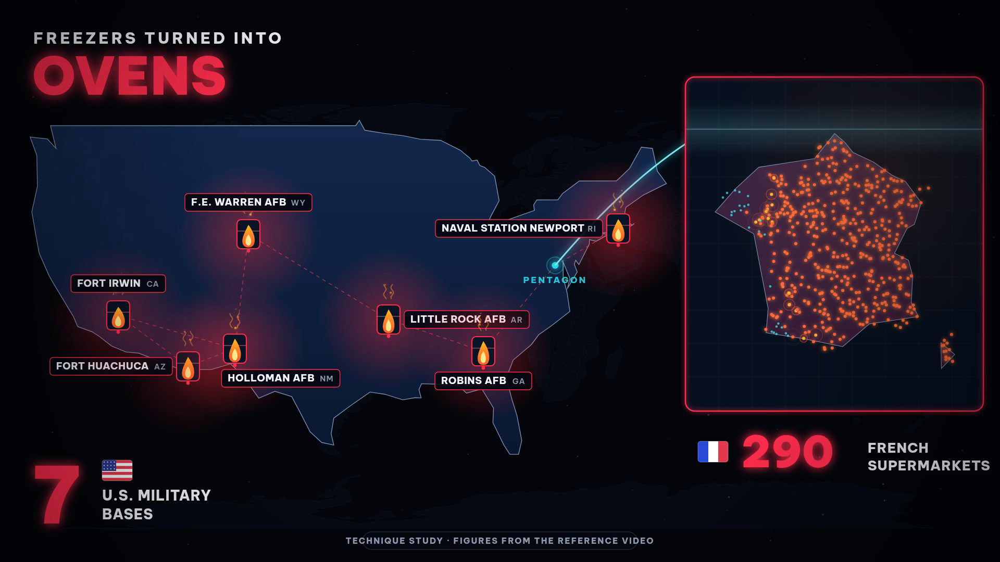

**Border Flood** — màu đế chế tràn qua biên giới, đồng hồ năm ở góc:

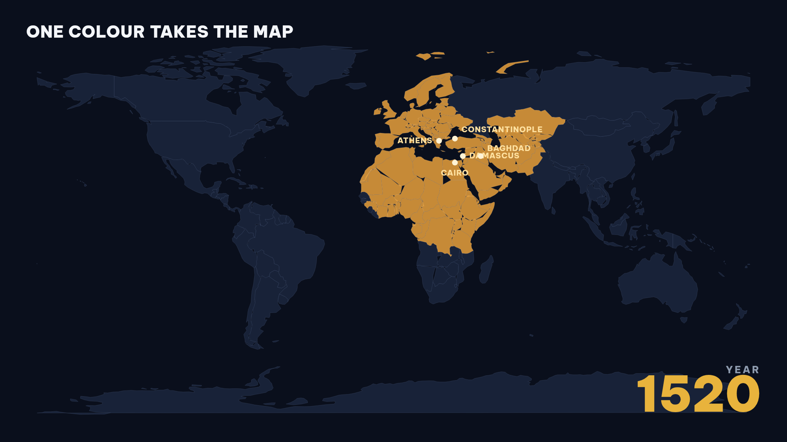

**Chat Thread** — câu chuyện là một luồng tin nhắn, tin cuối treo một mình:

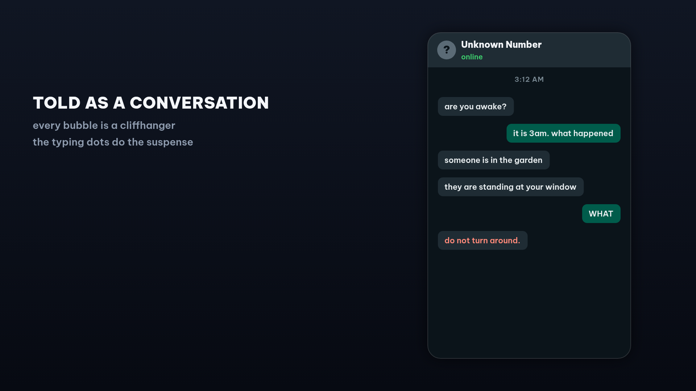

**Case File** — hồ sơ vụ án: ảnh bằng chứng, dây nối đỏ, tem trạng thái:

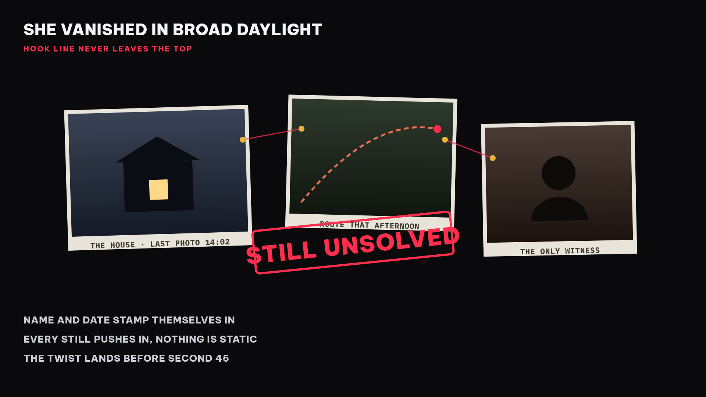

**Bar Race** — các cột đổi hạng theo năm, lần vượt mặt là cú ngoặt:

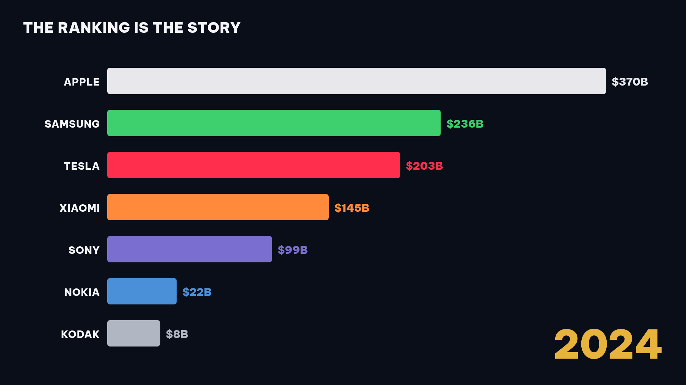

**Money River** — dòng tiền Sankey, bề rộng dải bằng số tiền:

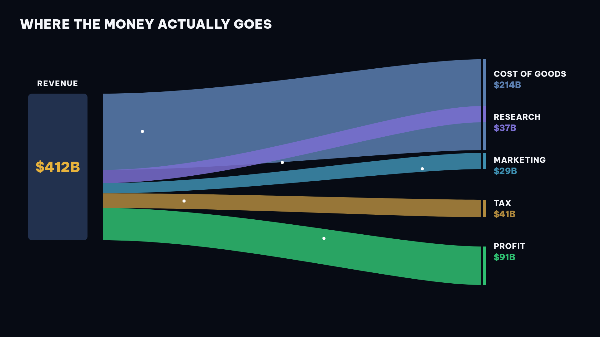

**Rise and Fall** — đường đời một công ty: leo đỉnh rồi rơi khỏi vách:

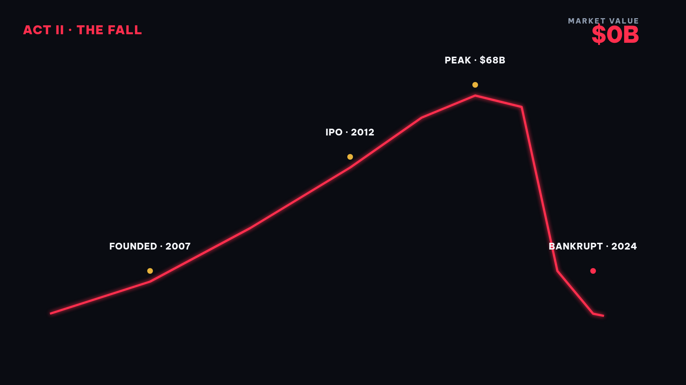

**Paper Collage** — giấy báo cũ, ảnh cắt halftone, một màu đỏ nóng, tem xác minh:

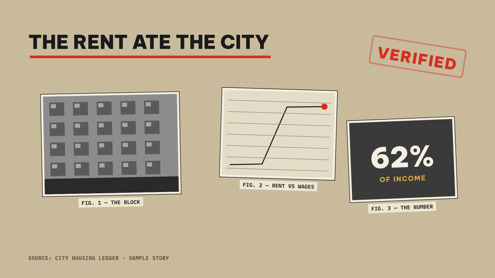

**Threshold Tracker** — bản đồ lật màu, thanh phiếu hướng về vạch 270, kim rung:

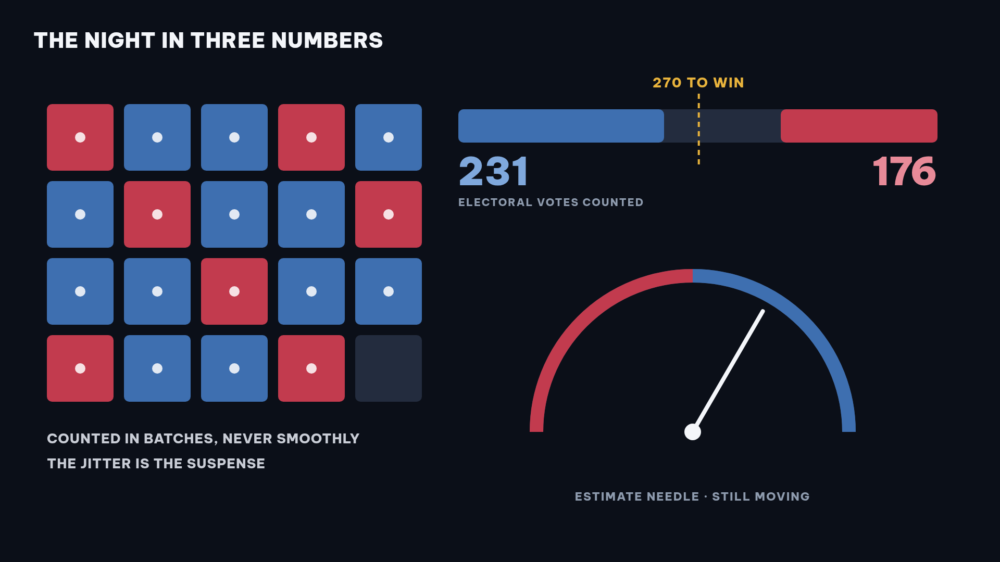

**Slider Evidence** — trượt trước và sau trên cùng một khung, đếm thiệt hại trên ảnh:

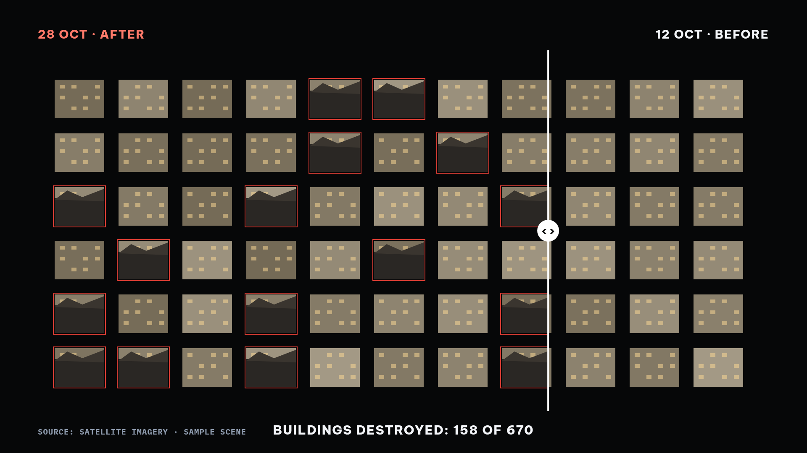

**Analog Horror** — đài KTV-9 và lịch phát sóng có một mục không nên xem:

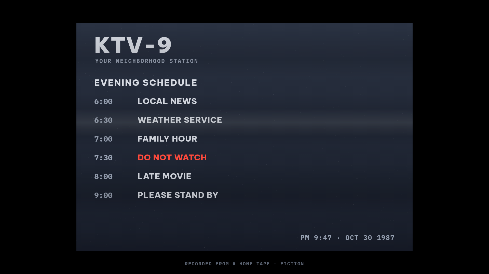

**Alert Hijack** — cảnh báo khẩn bị ghi đè bởi chỉ dẫn trái ngược:

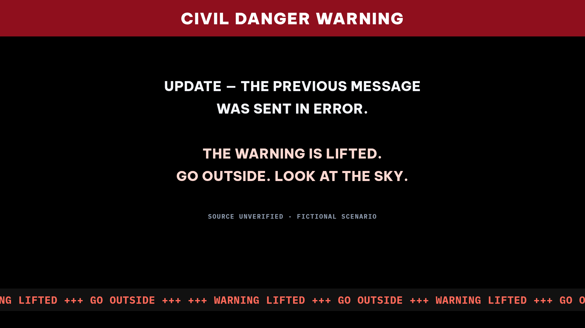

**Ghost Radio** — một tranh đêm, mưa và sương, cửa sổ vừa sáng đèn:

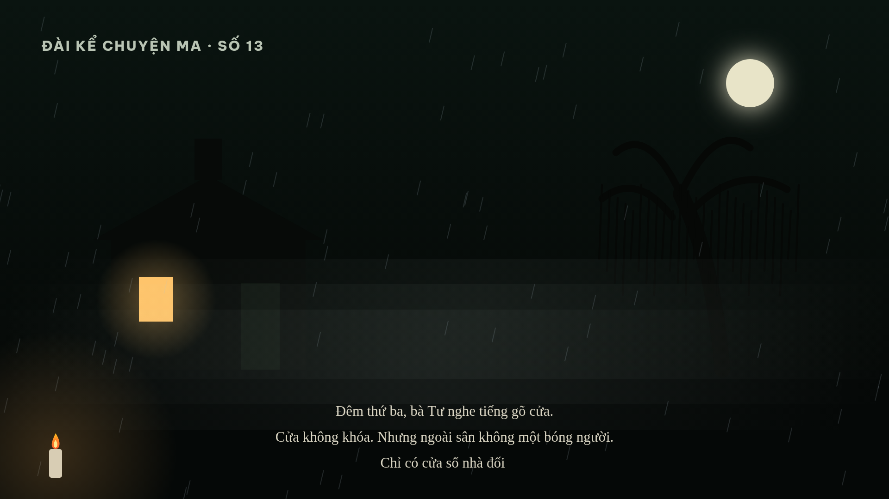

**Hundred Candles** — trăm nến tắt dần theo nhịp truyện, còn lại 2 ngọn:

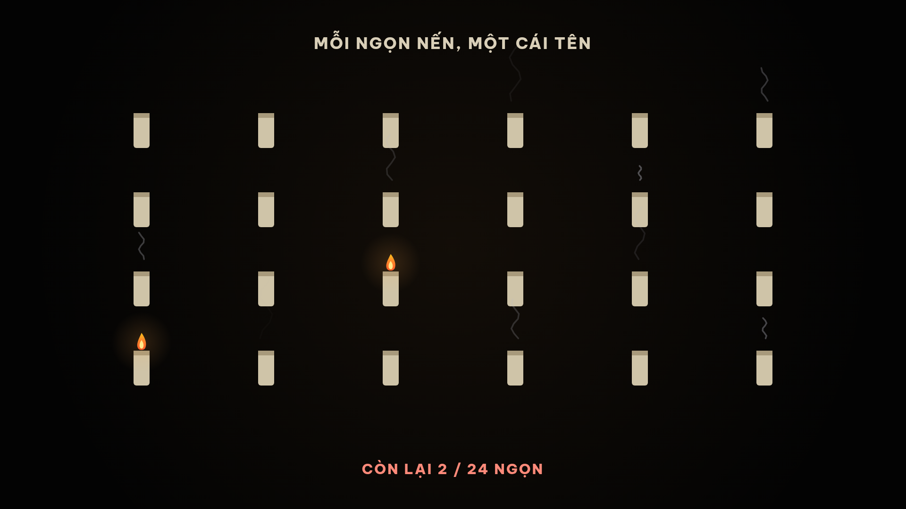

Trừ Chart Duel và Investigation là khung thật từ video đã sản xuất, các ảnh còn lại dùng số liệu mẫu để minh họa phong cách (có gắn nhãn “Style demo · Sample data” ngay trong ảnh). Thư viện này sẽ được bổ sung thêm phong cách mới theo thời gian.

## Nguyên tắc cốt lõi

- **Kiểm chứng mọi con số từ nguồn gốc trước khi vẽ.** Mục nào không có nguồn thì bỏ và nói rõ lý do. Không trình bày kế hoạch được báo cáo như thoả thuận đã ký, không trình bày ước tính như số đo thật.
- Một video = một khẳng định + một con số chính + 3 đến 7 nhãn phụ.
- Dữ liệu phải tự chuyển động: số đếm, cột mọc, đường rơi, nhãn hiện theo thứ tự. Cấm gọi ảnh tĩnh zoom chậm là animation.
- Bố cục theo vùng cố định, đo bề rộng chữ trong code để không bao giờ trùng nhau.
- Có giọng đọc một người khớp từng pha hình, phụ đề theo đoạn; nhạc nền sáng tác riêng (hợp âm, bass, kick, arpeggio) với riser và impact đúng khoảnh khắc chốt.
- Thời lượng 8–28 giây cho bản dữ liệu thuần; tới khoảng 36 giây khi có giọng đọc và pha điều tra.

## Cấu trúc repo

```
SKILL.md                              # Tài liệu skill đầy đủ (quy trình + luật)
skill.yaml                            # Khai báo để agent nhận diện và nạp skill
references/alec-reference-videos.md   # Ghi chú 8 video tham chiếu kèm link gốc
references/genre-styles-research.md   # Nghiên cứu 30/10/2026: các định dạng kể truyện, kinh tế, tin tức, truyện ma
examples/binance-hack/                # Ví dụ hoàn chỉnh: vụ hack Binance 29/10/2026
examples/chip-route-long/             # Ví dụ bản dài 68 giây: The Chip Route (hook + panel ảnh + SFX)
examples/new-styles/                  # Mã sản xuất reel 13 phong cách thể loại mới (ảnh tĩnh + reel 71,5 giây)
```

## Cách dùng

1. Sao chép thư mục này vào thư mục skills của agent (ví dụ `~/workspace/custom-skills/alec_dark_data_video/` đối với Muse), hoặc đưa toàn bộ nội dung `SKILL.md` cho AI assistant của bạn làm hướng dẫn.
2. Khi cần làm video, chỉ cần nói chủ đề. Agent sẽ chọn mẫu, kiểm chứng số liệu, dựng thử vài giây để soi khung hình, rồi mới render bản đầy đủ.
3. Quy trình render tham chiếu: HTML/Canvas vẽ cảnh, Playwright + Chromium chụp từng khung hình, ffmpeg ghép hình và tiếng.

## Ví dụ

Thư mục [examples/binance-hack](examples/binance-hack/) chứa toàn bộ mã nguồn của một video thật đã sản xuất theo skill này (mẫu Chart Duel + pha Investigation): kịch bản cảnh, mã chụp khung hình, mã sinh nhạc nền, mã sinh giọng đọc và file ghi nguồn số liệu. Xem hướng dẫn chạy trong [examples/binance-hack/README.md](examples/binance-hack/README.md).

Thư mục [examples/chip-route-long](examples/chip-route-long/) chứa mã nguồn của video bản dài 68 giây “The Chip Route”: mở bằng hook khoá mục tiêu, 4 panel ảnh minh họa, bảng bằng chứng và lớp hiệu ứng âm thanh riêng, toàn bộ số liệu thật đã kiểm chứng. Xem [examples/chip-route-long/README.md](examples/chip-route-long/README.md).

Thư mục [examples/new-styles](examples/new-styles/) chứa mã nguồn reel giới thiệu 13 phong cách thể loại mới: 13 cảnh Canvas độc lập dùng chung một khung reel, chụp ảnh tĩnh cho thư viện và chụp đủ 2.145 khung hình cho reel 71,5 giây có nhạc nền và lớp hiệu ứng riêng. Xem [examples/new-styles/README.md](examples/new-styles/README.md).

## Giấy phép

MIT — xem [LICENSE](LICENSE). Các video tham chiếu thuộc về tác giả gốc @ItsRealAlec; repo này chỉ ghi lại công thức trình bày rút ra từ đó.
